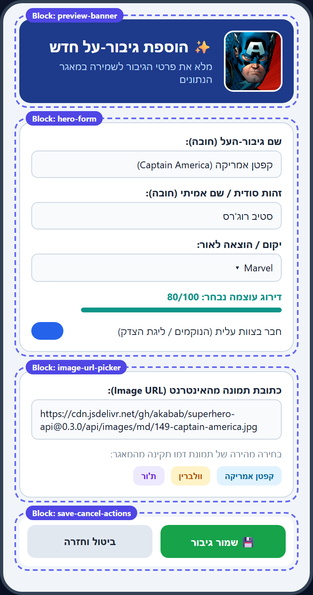
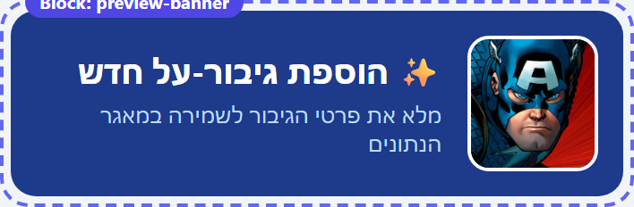
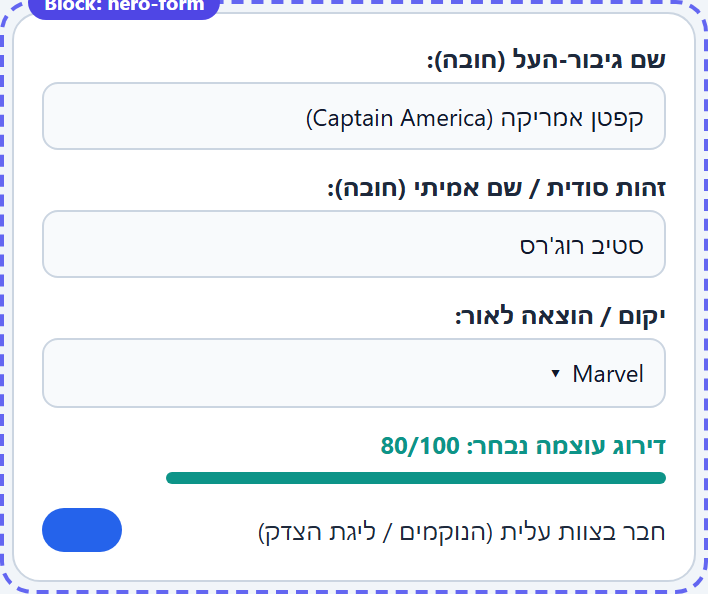
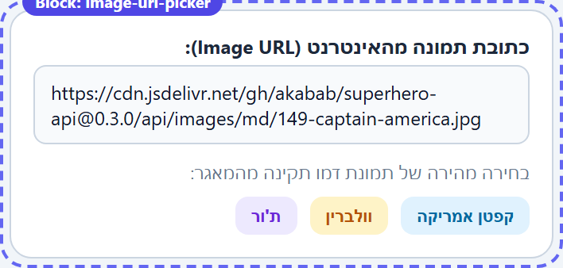
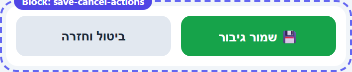

# AddHeroPage — מסך הוספת גיבור-על חדש (Create)

## מטרת הפרק

- **מה הלומד יראה ויוכל לעשות:** מילוי טופס הוספת גיבור-על חדש עם תצוגה מקדימה חיה של תמונת הגיבור מהאינטרנט, אימות קלט בזמן אמת באמצעות `CanExecute`, ושמירת הרשומה החדשה בשירות הנתונים (`AddHeroAsync`).
- **עובדות הפרויקט הנוכחיות:** המסך ממומש בקבצים `LearnSqlite/Views/AddHeroPage.xaml`, `LearnSqlite/Views/AddHeroPage.xaml.cs` ו-`LearnSqlite/ViewModels/AddHeroViewModel.cs`.
- **מדוע זו אבן הדרך השנייה:** המסך מדגים את פעולת ה-**Create** (`INSERT`) ב-CRUD ואת השילוב של פקדי קלט מגוונים (`Entry`, `Picker`, `Slider`, `Switch`) לקראת שמירה במסד הנתונים.

## מפת הדרך

| מצב נוכחי | אבן דרך זו | אבן הדרך הבאה | מושג מפתח |
| --- | --- | --- | --- |
| מסך אוסף (`HeroesListPage`) פעיל | טופס הוספת רשומה חדשה (`AddHeroAsync`) | מסך פרטים, עדכון ומחיקה (`HeroDetailsPage`) | אימות קלט עם `Command.CanExecute` |

## מפת הבלוקים של המסך



> תמונה זו היא מודל הוראה חזותי ב-HTML (אינה צילום אמולטור). המימוש ב-.NET MAUI נבדק ומאומת בנפרד.

| בלוק | קובץ ושכבה | מטרה | ראיה / אימות |
| --- | --- | --- | --- |
| `preview-banner` | `Views/AddHeroPage.xaml` | באנר כותרת עם תצוגה מקדימה חיה של `ImageUrl` | שינוי ה-URL מעדכן מיד את ה-`Image` |
| `hero-form` | `Views/AddHeroPage.xaml` | שדות הקלט (`Name`, `AlterEgo`, `Publisher`, `PowerLevel`, `IsEliteMember`) | קישור Two-Way למאפייני `AddHeroViewModel` |
| `image-url-picker` | `Views/AddHeroPage.xaml` | שדה URL לתמונה + 3 כפתורי דמו מהירים | לחיצה על כפתור דמו ממלאת URL תקין |
| `save-cancel-actions` | `Views/AddHeroPage.xaml` | כפתורי שמירה (`SaveHeroCommand`) וביטול (`CancelCommand`) | כפתור השמירה פעיל רק כשכל שדות החובה מלאים |

---

## בלוק 1 — באנר כותרת ותצוגה מקדימה של התמונה (`preview-banner`)

### מה משתנה
מוסיפים בראש המסך כרטיס המציג תמונת תצוגה מקדימה (`Image`) המקושרת ישירות ל-`ImageUrl` שב-ViewModel, כך שהתלמיד רואה מיד שהכתובת שהזין תקינה ונטענת מהאינטרנט.

### היכן הקוד יושב ומדוע
התצוגה יושבת ב-`LearnSqlite/Views/AddHeroPage.xaml`, והמאפיין `ImageUrl` יושב ב-`LearnSqlite/ViewModels/AddHeroViewModel.cs`.

### שינוי הקוד ב-XAML

```xml
<!-- מתוך LearnSqlite/Views/AddHeroPage.xaml -->
<Border StrokeShape="RoundRectangle 16"
        BackgroundColor="#1E3A8A"
        StrokeThickness="0"
        Padding="16">
    <Grid ColumnDefinitions="84,*"
          ColumnSpacing="14">
        <Border Grid.Column="0"
                StrokeShape="RoundRectangle 14"
                Stroke="White"
                StrokeThickness="2"
                HeightRequest="84"
                WidthRequest="84"
                BackgroundColor="#334155">
            <Image Source="{Binding ImageUrl}"
                   Aspect="AspectFill"
                   HeightRequest="84"
                   WidthRequest="84" />
        </Border>

        <VerticalStackLayout Grid.Column="1"
                             Spacing="4"
                             VerticalOptions="Center">
            <Label Text="✨ הוספת גיבור-על חדש"
                   FontSize="19"
                   FontAttributes="Bold"
                   TextColor="White" />
            <Label Text="מלא את פרטי הגיבור לשמירה במאגר הנתונים"
                   FontSize="13"
                   TextColor="#BFDBFE" />
        </VerticalStackLayout>
    </Grid>
</Border>
```

### מדוע זה עובד
פקד `Image` ב-.NET MAUI יודע לטעון אוטומטית תמונות מכתובת `https://` כאשר `Source` קשור למחרוזת URL. בכל פעם שערך `ImageUrl` ב-ViewModel משתנה, אירוע `OnPropertyChanged` גורם לפקד ה-`Image` לרענן את התמונה המוצגת.



### נקודת בקרה לתלמיד

> [!TIP]
> כיצד פקד ה-`Image` בראש המסך יודע להתעדכן מיד כאשר המשתמש מדביק כתובת URL חדשה בתיבת הטקסט שבתחתית הטופס?

### אימות
- עם פתיחת המסך מוצגת תמונת ברירת המחדל של קפטן אמריקה מתוך ה-CDN.

---

## בלוק 2 — טופס הזנת פרטי הגיבור (`hero-form`)

### מה משתנה
בונים את כרטיס הקלט המרכזי הכולל `Entry` לשם ולזהות הסודית, `Picker` לבחירת יקום הקומיקס, `Slider` לבחירת דירוג עוצמה (1–100), ו-`Switch` לבחירת שייכות לצוות עלית.

### היכן הקוד יושב ומדוע
פקדי הקלט נמצאים ב-`LearnSqlite/Views/AddHeroPage.xaml`, ומאפייני ה-State ואימות הקלט (`CanSaveHero`) נמצאים ב-`LearnSqlite/ViewModels/AddHeroViewModel.cs`.

### שינוי הקוד ב-XAML וב-ViewModel

```xml
<!-- מתוך LearnSqlite/Views/AddHeroPage.xaml -->
<Border StrokeShape="RoundRectangle 14"
        BackgroundColor="White"
        Stroke="#CBD5E1"
        StrokeThickness="1"
        Padding="16">
    <VerticalStackLayout Spacing="12">
        <Label Text="שם גיבור-העל (חובה):"
               FontSize="13"
               FontAttributes="Bold"
               TextColor="#1E293B" />
        <Entry Placeholder="למשל: קפטן אמריקה (Captain America)"
               Text="{Binding Name}"
               TextColor="#0F172A" />

        <Label Text="זהות סודית / שם אמיתי (חובה):"
               FontSize="13"
               FontAttributes="Bold"
               TextColor="#1E293B" />
        <Entry Placeholder="למשל: סטיב רוג'רס"
               Text="{Binding AlterEgo}"
               TextColor="#0F172A" />

        <Label Text="יקום / הוצאה לאור:"
               FontSize="13"
               FontAttributes="Bold"
               TextColor="#1E293B" />
        <Picker Title="בחר יקום קומיקס"
                ItemsSource="{Binding AvailablePublishers}"
                SelectedItem="{Binding Publisher}"
                TextColor="#0F172A" />

        <Label Text="{Binding PowerLevelDisplay}"
               FontSize="13"
               FontAttributes="Bold"
               TextColor="#0D9488" />
        <Slider Minimum="1"
                Maximum="100"
                Value="{Binding PowerLevel}"
                MinimumTrackColor="#0D9488"
                ThumbColor="#0F766E" />
    </VerticalStackLayout>
</Border>
```

```csharp
// מתוך LearnSqlite/ViewModels/AddHeroViewModel.cs
public string Name
{
    get => _name;
    set
    {
        if (_name != value)
        {
            _name = value;
            OnPropertyChanged();
            RefreshCommands();
        }
    }
}

public bool CanSaveHero()
{
    return IsNotLoading &&
           !string.IsNullOrWhiteSpace(Name) &&
           !string.IsNullOrWhiteSpace(AlterEgo) &&
           !string.IsNullOrWhiteSpace(ImageUrl) &&
           PowerLevel >= 1 &&
           PowerLevel <= 100;
}
```

### מדוע זה עובד
בכל שינוי של `Name`, `AlterEgo`, או `ImageUrl`, מתודת ה-`set` קוראת ל-`RefreshCommands()`, המפעילה את `((Command)SaveHeroCommand).ChangeCanExecute()`. כך כפתור ה"שמור גיבור" נפתח ללחיצה אך ורק כאשר כל שדות החובה הוזנו כראוי — ללא צורך בשימוש ב-`IsEnabled` ידני ב-XAML!



### נקודת בקרה לתלמיד

> [!TIP]
> מדוע אנו קוראים ל-`RefreshCommands()` בתוך ה-`set` של `Name` ו-`AlterEgo`? מה היה קורה לכפתור השמירה אם היינו שוכחים שורה זו?

### אימות
- כאשר שדה `Name` או `AlterEgo` ריק, כפתור `💾 שמור גיבור` מושבת (Disabled).
- מילוי שני השדות מפעיל מיד את כפתור השמירה.

---

## בלוק 3 — כתובת תמונה מהאינטרנט וכפתורי בחירה מהירה (`image-url-picker`)

### מה משתנה
מוסיפים שדה `Entry` עבור `ImageUrl` (עם `FlowDirection="LeftToRight"` כנדרש עבור כתובות אינטרנט באנגלית) ו-3 כפתורי עזר המאפשרים לתלמיד למלא בלחיצה אחת כתובות תמונה תקינות מתוך מאגר Superhero-API.

### היכן הקוד יושב ומדוע
הכפתורים נמצאים ב-`AddHeroPage.xaml` ומעבירים `CommandParameter` אל הפקודה `UsePresetHeroImageCommand` ב-`AddHeroViewModel.cs`.

### שינוי הקוד ב-XAML וב-ViewModel

```xml
<!-- מתוך LearnSqlite/Views/AddHeroPage.xaml -->
<Entry Placeholder="https://..."
       Text="{Binding ImageUrl}"
       FlowDirection="LeftToRight"
       TextColor="#0F172A" />

<HorizontalStackLayout Spacing="8">
    <Button Text="קפטן אמריקה"
            Command="{Binding UsePresetHeroImageCommand}"
            CommandParameter="CaptainAmerica"
            BackgroundColor="#E0F2FE"
            TextColor="#0369A1"
            FontSize="12"
            CornerRadius="8" />
    <Button Text="וולברין"
            Command="{Binding UsePresetHeroImageCommand}"
            CommandParameter="Wolverine"
            BackgroundColor="#FEF3C7"
            TextColor="#B45309"
            FontSize="12"
            CornerRadius="8" />
    <Button Text="ת'ור"
            Command="{Binding UsePresetHeroImageCommand}"
            CommandParameter="Thor"
            BackgroundColor="#EDE9FE"
            TextColor="#6D28D9"
            FontSize="12"
            CornerRadius="8" />
</HorizontalStackLayout>
```

```csharp
// מתוך LearnSqlite/ViewModels/AddHeroViewModel.cs
private void ApplyPresetHeroImage(string? presetKey)
{
    ImageUrl = presetKey switch
    {
        "Wolverine" => "https://cdn.jsdelivr.net/gh/akabab/superhero-api@0.3.0/api/images/md/717-wolverine.jpg",
        "Thor" => "https://cdn.jsdelivr.net/gh/akabab/superhero-api@0.3.0/api/images/md/659-thor.jpg",
        _ => "https://cdn.jsdelivr.net/gh/akabab/superhero-api@0.3.0/api/images/md/149-captain-america.jpg"
    };
}
```

### מדוע זה עובד
שימוש ב-`Command<string>` עם `CommandParameter` מאפשר לנו להשתמש בפקודה אחת בלבד ב-ViewModel עבור מספר כפתורי בחירה מהירה, במקום לשכפל שלוש פקודות נפרדות.



### נקודת בקרה לתלמיד

> [!TIP]
> מדוע הגדרנו `FlowDirection="LeftToRight"` על תיבת ה-`Entry` של כתובת ה-URL, למרות שהמסך כולו מוגדר כ-`RightToLeft`?

### אימות
- לחיצה על "וולברין" או "ת'ור" מחליפה את ה-URL בתיבה ומעדכנת מיד את התמונה בראש המסך.

---

## בלוק 4 — שמירה בשירות הנתונים וחזרה לארכיון (`save-cancel-actions`)

### מה משתנה
מחברים את כפתור השמירה לפקודת `SaveHeroCommand`, היוצרת מופע `HeroItem` חדש, שולחת אותו ל-`_heroService.AddHeroAsync(newHero)`, ומנווטת חזרה למסך האוסף באמצעות `Shell.Current.GoToAsync("..")`.

### היכן הקוד יושב ומדוע
הכפתורים יושבים ב-`AddHeroPage.xaml`, ולוגיקת השמירה והניווט חזור יושבת ב-`AddHeroViewModel.cs`.

### שינוי הקוד ב-XAML וב-ViewModel

```xml
<!-- מתוך LearnSqlite/Views/AddHeroPage.xaml -->
<Grid ColumnDefinitions="*,*"
      ColumnSpacing="12">
    <Button Grid.Column="0"
            Text="💾 שמור גיבור"
            Command="{Binding SaveHeroCommand}"
            BackgroundColor="#16A34A"
            TextColor="White"
            FontAttributes="Bold"
            CornerRadius="12"
            HeightRequest="48" />

    <Button Grid.Column="1"
            Text="ביטול וחזרה"
            Command="{Binding CancelCommand}"
            BackgroundColor="#E2E8F0"
            TextColor="#1E293B"
            FontAttributes="Bold"
            CornerRadius="12"
            HeightRequest="48" />
</Grid>
```

```csharp
// מתוך LearnSqlite/ViewModels/AddHeroViewModel.cs
public async Task SaveHeroAsync()
{
    if (!CanSaveHero())
    {
        return;
    }

    try
    {
        IsLoading = true;
        var newHero = new HeroItem
        {
            Name = Name.Trim(),
            AlterEgo = AlterEgo.Trim(),
            Publisher = Publisher.Trim(),
            PowerLevel = PowerLevel,
            IsEliteMember = IsEliteMember,
            ImageUrl = ImageUrl.Trim()
        };

        int rowsAffected = await _heroService.AddHeroAsync(newHero);
        if (rowsAffected > 0 && Shell.Current is not null)
        {
            await Shell.Current.GoToAsync("..");
        }
    }
    finally
    {
        IsLoading = false;
    }
}
```

### מדוע זה עובד
הניווט `".."` ב-Shell מסיר את מסך ההוספה ממחסנית הניווט ומחזיר את המשתמש אל `HeroesListPage`. ברגע ש-`HeroesListPage` מופיע מחדש, מתודת `OnAppearing` שלו מופעלת והגיבור החדש מופיע מיד ברשימה!



### נקודת בקרה לתלמיד

> [!TIP]
> מדוע איננו קובעים את השדה `Id` של `newHero` בתוך `AddHeroViewModel`? מי אחראי לקבוע את ה-`Id` עכשיו ב-`MockHeroService`, ומי יקבע אותו כשנעבור ל-SQLite?

### אימות
- מילוי פרטי גיבור חדש ולחיצה על `💾 שמור גיבור` מחזירה למסך האוסף ומגדילה את מספר הגיבורים מ-6 ל-7.

---

## רפלקציה והצעד הבא

- **החלטה ארכיטקטונית:** השארנו את הקצאת ה-`Id` לשירות הנתונים (ולא ל-ViewModel) משום שב-SQLite המפתח הראשי נקבע אוטומטית ע"י מסד הנתונים (`[PrimaryKey, AutoIncrement]`).
- **שאלה למחשבה:** מדוע עטפנו את הקריאה ל-`_heroService.AddHeroAsync` בבלוק `try-catch-finally` שבו `IsLoading = false` מתבצע תמיד ב-`finally`?
- **אתגר קטן:** הוסיפו תנאי ב-`CanSaveHero()` המוודא שכתובת התמונה מתחילה ב-`https://`.

## מקורות
- תיעוד רשמי של Microsoft Learn עבור `.NET MAUI Commanding` ו-`Data Binding`.
