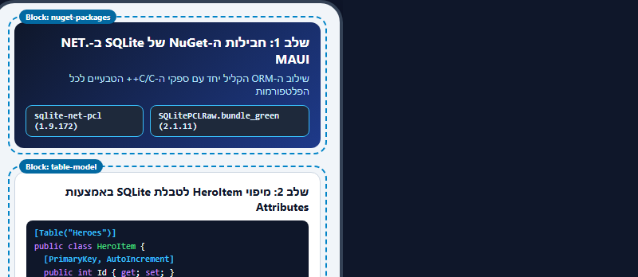
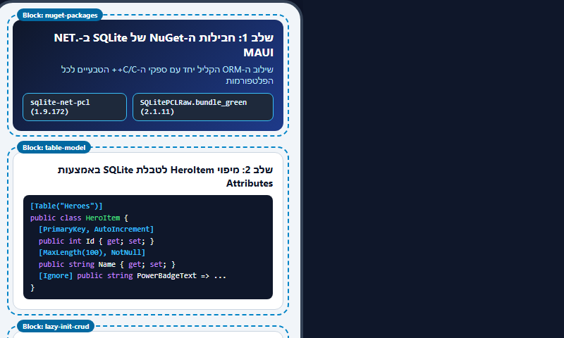
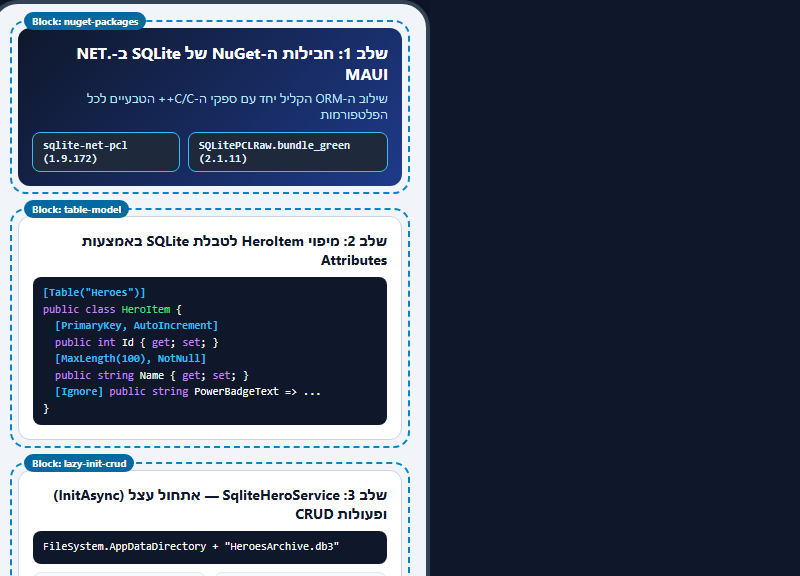
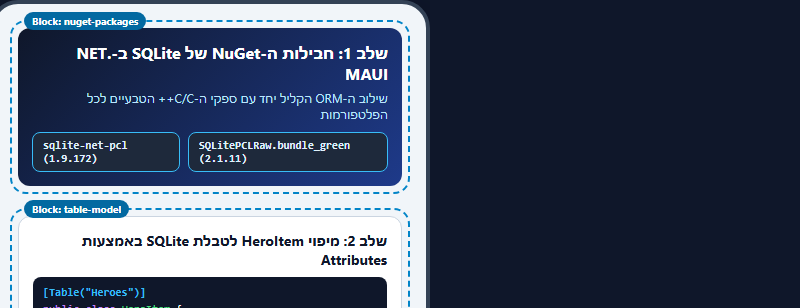

# מדריך נפרד ומלא: התקנת SQLite והגדרתו בפרויקט .NET MAUI (`LearnSqlite`)

מדריך זה מרכז צעד-אחר-צעד את כל תהליך המעבר מפרויקט הבסיס (ענף `master` העובד עם `MockHeroService` בזיכרון) לפרויקט המחובר למסד נתונים מקומי אמיתי מסוג **SQLite** (ענף `sqlite` העובד עם `SqliteHeroService`).


---

## שלב 1: הבנת חבילות ה-NuGet והתקנתן בפרויקט



### 1.1 מדוע אנו מתקינים שתי חבילות שונות?
בפרויקט .NET MAUI הרץ על מספר מערכות הפעלה (Android, Windows, iOS, MacCatalyst), אנו זקוקים לשתי שכבות המשלימות זו את זו:

| שם החבילה | גרסה מומלצת | תפקיד החבילה בפרויקט |
| :--- | :--- | :--- |
| **`sqlite-net-pcl`** | `1.9.172` | ספריית **ORM** (Object-Relational Mapper) קלילה ונוחה ב-C#. מאפשרת להפוך מחלקת C# (`HeroItem`) לטבלה במסד הנתונים ולבצע פעולות שליפה, הוספה, עדכון ומחיקה א-סינכרוניות (`SQLiteAsyncConnection`) באמצעות קוד C# ו-LINQ, ללא כתיבת משפטי SQL ידניים. |
| **`SQLitePCLRaw.bundle_green`** | `2.1.11` | מנוע SQLite עצמו כתוב בשפת C. חבילת ה-"Batteries Included" הזו מספקת את קובצי המנוע הבינאריים (`e_sqlite3`) עבור כל פלטפורמה (Android, Windows וכו') ומחברת אותם אל .NET בזמן ריצה. |

---

### 1.2 אופן ההתקנה (בחר אחת משתי הדרכים)

#### אפשרות א': התקנה דרך Visual Studio (ממשק גרפי)
1. ב-**Solution Explorer**, לחץ קליק ימני על הפרויקט **`LearnSqlite`** ובחר **Manage NuGet Packages...**.
2. עבור ללשונית **Browse**.
3. חפש את **`sqlite-net-pcl`** (מאת *Frank A. Krueger*), סמן אותה ולחץ **Install**.
4. חפש את **`SQLitePCLRaw.bundle_green`** (מאת *Eric Sink*), סמן אותה ולחץ **Install**.

#### אפשרות ב': התקנה דרך הטרמינל (Package Manager Console / PowerShell)
הרץ בתיקיית הפרויקט את שתי הפקודות הבאות:

```powershell
dotnet add LearnSqlite/LearnSqlite.csproj package sqlite-net-pcl --version 1.9.172
dotnet add LearnSqlite/LearnSqlite.csproj package SQLitePCLRaw.bundle_green --version 2.1.11
```

#### בדיקה בקובץ הפרויקט (`LearnSqlite/LearnSqlite.csproj`)
לאחר ההתקנה, ודא שבקובץ `LearnSqlite.csproj` מופיעות שתי השורות הבאות בתוך `<ItemGroup>`:

```xml
<ItemGroup>
    <PackageReference Include="Microsoft.Maui.Controls" Version="$(MauiVersion)" />
    <PackageReference Include="Microsoft.Extensions.Logging.Debug" Version="10.0.0" />
    <PackageReference Include="sqlite-net-pcl" Version="1.9.172" />
    <PackageReference Include="SQLitePCLRaw.bundle_green" Version="2.1.11" />
</ItemGroup>
```

---

## שלב 2: הגדרת המודל `HeroItem` כטבלת SQLite (`Models/HeroItem.cs`)



כדי ש-`sqlite-net-pcl` ידע כיצד ליצור את הטבלה ואיזו עמודה היא המפתח הראשי, אנו מוסיפים `using SQLite;` ומעטרים את המחלקה `HeroItem` בתכונות (**Attributes**):

### 2.1 טבלת התכונות (Attributes) שבהן אנו משתמשים

| תכונה (Attribute) | היכן ממוקמת? | משמעות במסד הנתונים SQLite |
| :--- | :--- | :--- |
| **`[Table("Heroes")]`** | מעל ה-`class HeroItem` | קובע ששם הטבלה בקובץ ה-SQLite יהיה `Heroes`. |
| **`[PrimaryKey]`** | מעל `public int Id` | מגדיר את עמודת `Id` כמפתח הראשי הייחודי של כל רשומה בטבלה (`PRIMARY KEY`). |
| **`[AutoIncrement]`** | מעל `public int Id` | מורה ל-SQLite למספר אוטומטית כל רשומה חדשה שמתווספת (`1, 2, 3...`) ולעדכן את `hero.Id` לאחר `InsertAsync`. |
| **`[MaxLength(100), NotNull]`** | מעל `public string Name` | מגביל את אורך הטקסט וקובע שאסור לשמור ערך `NULL` בעמודת השם. |
| **`[Ignore]`** | מעל `PowerBadgeText` ו-`EliteStatusText` | מורה ל-SQLite **להתעלם** ממאפיינים אלו ולא ליצור עבורם עמודה בטבלה, משום שהם מאפייני עזר מחושבים לתצוגה בלבד (`get` בלבד). |

### 2.2 הקוד המלא של `LearnSqlite/Models/HeroItem.cs`

```csharp
using SQLite;

namespace LearnSqlite.Models;

/// <summary>
/// מודל הנתונים המייצג רשומת גיבור-על בטבלת Heroes במסד הנתונים SQLite.
/// </summary>
[Table("Heroes")]
public class HeroItem
{
    /// <summary>
    /// מזהה ייחודי של הרשומה — מפתח ראשי (PrimaryKey) עם מספור אוטומטי (AutoIncrement) ב-SQLite.
    /// </summary>
    [PrimaryKey, AutoIncrement]
    public int Id { get; set; }

    /// <summary>
    /// שם גיבור-העל (למשל: באטמן, ספיידרמן).
    /// </summary>
    [MaxLength(100), NotNull]
    public string Name { get; set; } = string.Empty;

    /// <summary>
    /// זהות סודית / שם אמיתי (למשל: ברוס ויין, פיטר פארקר).
    /// </summary>
    [MaxLength(100)]
    public string AlterEgo { get; set; } = string.Empty;

    /// <summary>
    /// הוצאה לאור / יקום קומיקס (Marvel / DC).
    /// </summary>
    [MaxLength(50)]
    public string Publisher { get; set; } = "Marvel";

    /// <summary>
    /// דירוג עוצמה מספרי (1 עד 100) — נשמר כעמודת INTEGER.
    /// </summary>
    public int PowerLevel { get; set; } = 75;

    /// <summary>
    /// האם חבר בצוות עלית (הנוקמים / ליגת הצדק) — נשמר כעמודה בוליאנית (0/1).
    /// </summary>
    public bool IsEliteMember { get; set; }

    /// <summary>
    /// כתובת תמונה ישירה מהאינטרנט (URL).
    /// </summary>
    public string ImageUrl { get; set; } = string.Empty;

    /// <summary>
    /// מאפיין עזר מחושב לתצוגה בלבד — מסומן ב-[Ignore] כדי שלא ימופה לעמודה בטבלה.
    /// </summary>
    [Ignore]
    public string PowerBadgeText => $"⚡ עוצמה: {PowerLevel}/100";

    /// <summary>
    /// מאפיין עזר מחושב לתצוגה בלבד — מסומן ב-[Ignore] כדי שלא ימופה לעמודה בטבלה.
    /// </summary>
    [Ignore]
    public string EliteStatusText => IsEliteMember ? "⭐ חבר צוות עלית" : "🛡️ פועל עצמאית";
}
```

---

## שלב 3: הגדרת שירות מסד הנתונים `SqliteHeroService` (`Services/SqliteHeroService.cs`)



בשלב זה אנו יוצרים בתיקיית `Services` מחלקה חדשה בשם `SqliteHeroService` המממשת את אותו ממשק בדיוק (`IHeroService`) כמו `MockHeroService`.

### 3.1 הגדרת נתיב הקובץ ודגלי הפתיחה (`DatabasePath` ו-`Flags`)
באפליקציית .NET MAUI שלעולם אינה יודעת מראש אם היא רצה על מכשיר אנדרואיד, אייפון או מחשב Windows, אסור להשתמש בנתיבים קשיחים כמו `"C:\\data\\db.db3"`.  
במקום זאת, אנו משתמשים ב-`FileSystem.AppDataDirectory` של .NET MAUI, שמחזיר את תיקיית הנתונים הפרטית והבטוחה של האפליקציה בכל מערכת הפעלה:

```csharp
public const string DatabaseFilename = "HeroesArchive.db3";

public const SQLiteOpenFlags Flags =
    SQLiteOpenFlags.ReadWrite |    // פתיחת הקובץ לקריאה ולכתיבה
    SQLiteOpenFlags.Create |       // יצירת קובץ מסד הנתונים אוטומטית אם אינו קיים עדיין
    SQLiteOpenFlags.SharedCache;   // שיתוף מטמון לעבודה תקינה בריבוי תהליכונים (Multi-threaded)

public static string DatabasePath =>
    Path.Combine(FileSystem.AppDataDirectory, DatabaseFilename);
```

---

### 3.2 אתחול א-סינכרוני עצל (`InitAsync`) וזריעת נתוני פתיחה (`Seeding`)

> **כלל ארכיטקטורה קריטי ב-.NET MAUI:**  
> **לעולם אין לבצע פתיחת קובץ, יצירת טבלה או קריאה למסד נתונים בתוך הבנאי (`Constructor`)!**  
> בנאי ב-C# הוא סינכרוני, וביצוע פעולות I/O בתוכו יחסום את ה-UI Thread או יגרום לקיפאון (Deadlock) אם משתמשים ב-`.Wait()` או `.Result`.

לכן הבנאי של `SqliteHeroService` נשאר ריק, ואנו כותבים מתודה פרטית `private async Task InitAsync()` שנקראת בתחילת כל מתודת CRUD:
1. אם `_database` כבר אותחל (`_database is not null`), המתודה חוזרת מיד באפס עלות.
2. בפעם הראשונה בלבד, אנו נועלים באמצעות `SemaphoreSlim` (כדי למנוע משתי קריאות מקבילות לאתחל את הטבלה יחד), יוצרים את `SQLiteAsyncConnection`, וקוראים ל-`await _database.CreateTableAsync<HeroItem>()`.
3. מיד לאחר יצירת הטבלה אנו בודקים כמה שורות קיימות בה (`await _database.Table<HeroItem>().CountAsync()`). אם הטבלה ריקה (`0`), אנו זורעים אליה אוטומטית את 6 גיבורי-העל ההתחלתיים באמצעות `InsertAllAsync`.

```csharp
private static SQLiteAsyncConnection? _database;
private static readonly SemaphoreSlim _initLock = new(1, 1);

public SqliteHeroService()
{
    // הבנאי ריק בכוונה — אין לבצע פעולות מסד נתונים בבנאי!
}

private async Task InitAsync()
{
    if (_database is not null)
    {
        return;
    }

    await _initLock.WaitAsync();
    try
    {
        if (_database is not null)
        {
            return;
        }

        _database = new SQLiteAsyncConnection(DatabasePath, Flags);

        // יצירת טבלת Heroes אם אינה קיימת עדיין בקובץ
        await _database.CreateTableAsync<HeroItem>();

        // זריעת 6 גיבורי פתיחה בהפעלה הראשונה בלבד (כאשר הטבלה ריקה)
        int existingCount = await _database.Table<HeroItem>().CountAsync();
        if (existingCount == 0)
        {
            var starterHeroes = GetSeedHeroes();
            await _database.InsertAllAsync(starterHeroes);
        }
    }
    finally
    {
        _initLock.Release();
    }
}
```

---

### 3.3 מימוש פעולות ה-CRUD של `IHeroService` מול SQLite

כל אחת מ-6 המתודות של הממשק קוראת תחילה ל-`await InitAsync();` ולאחר מכן מבצעת את הפעולה מול `_database`:

| מתודה ב-`IHeroService` | פקודת ה-`SQLiteAsyncConnection` | משפט ה-SQL שנוצר מאחורי הקלעים |
| :--- | :--- | :--- |
| **`GetAllHeroesAsync()`** | `_database.Table<HeroItem>().OrderByDescending(h => h.PowerLevel).ToListAsync()` | `SELECT * FROM Heroes ORDER BY PowerLevel DESC` |
| **`GetHeroByIdAsync(int id)`** | `_database.Table<HeroItem>().Where(h => h.Id == id).FirstOrDefaultAsync()` | `SELECT * FROM Heroes WHERE Id = ? LIMIT 1` |
| **`SearchHeroesAsync(string text)`** | `_database.Table<HeroItem>().Where(h => h.Name.ToLower().Contains(term) ...).ToListAsync()` | `SELECT * FROM Heroes WHERE lower(Name) LIKE '%...%'` |
| **`AddHeroAsync(HeroItem hero)`** | `_database.InsertAsync(hero)` | `INSERT INTO Heroes (...) VALUES (...)` |
| **`UpdateHeroAsync(HeroItem hero)`** | `_database.UpdateAsync(hero)` | `UPDATE Heroes SET ... WHERE Id = ?` |
| **`DeleteHeroAsync(int id)`** | `_database.DeleteAsync<HeroItem>(id)` | `DELETE FROM Heroes WHERE Id = ?` |

---

## שלב 4: חיבור `SqliteHeroService` למסכים (ללא שינוי ב-ViewModels או ב-XAML!)



כאן בא לידי ביטוי היתרון הגדול של תכנות מול ממשק (**`IHeroService`**) בארכיטקטורת **MVVM**:
* כל שלושת ה-ViewModels (`HeroesListViewModel`, `AddHeroViewModel`, `HeroDetailsViewModel`) מקבלים בבנאי שלהם את הטיפוס `IHeroService`.
* הם אינם יודעים ואינם צריכים לדעת אם הנתונים מגיעים מרשימה בזיכרון (`MockHeroService`) או מטבלת SQLite (`SqliteHeroService`).
* לכן **איננו משנים אף שורת קוד ב-ViewModels או בקובצי ה-XAML!**

כל מה שאנו משנים הוא החלפת `new MockHeroService()` ב-`new SqliteHeroService()` בשלושת קובצי ה-Code-Behind של המסכים:

### 1. ב-`LearnSqlite/Views/HeroesListPage.xaml.cs`:
```csharp
public HeroesListPage()
{
    InitializeComponent();

    // החלפת MockHeroService ב-SqliteHeroService בלבד:
    _viewModel = new HeroesListViewModel(new SqliteHeroService());
    BindingContext = _viewModel;
}
```

### 2. ב-`LearnSqlite/Views/AddHeroPage.xaml.cs`:
```csharp
public AddHeroPage()
{
    InitializeComponent();
    BindingContext = new AddHeroViewModel(new SqliteHeroService());
}
```

### 3. ב-`LearnSqlite/Views/HeroDetailsPage.xaml.cs`:
```csharp
public HeroDetailsPage()
{
    InitializeComponent();
    BindingContext = new HeroDetailsViewModel(new SqliteHeroService());
}
```

---

## שלב 5: בדיקת השמירה המתמשכת (Persistence Verification)

כדי להוכיח שהאפליקציה עובדת כעת מול קובץ ה-SQLite המקומי (`HeroesArchive.db3`) ולא מול הזיכרון הזמני:

1. **הפעלה ראשונה:** הרץ את האפליקציה (`F5`). מתודת `InitAsync()` תיצור את הקובץ `HeroesArchive.db3`, תיצור את טבלת `Heroes` ותזריע לתוכה את 6 גיבורי-העל ההתחלתיים.
2. **הוספת רשומה (`INSERT`):** לחץ על **"+ גיבור חדש"**, הוסף גיבור חדש (למשל *וולברין*) ולחץ **"שמור גיבור בארכיון"**.
3. **עדכון רשומה (`UPDATE`):** לחץ על אחד הגיבורים ברשימה, שנה את דירוג העוצמה שלו, ולחץ **"שמור עדכונים"**.
4. **מחיקת רשומה (`DELETE`):** פתח כרטיס גיבור ולחץ **"מחק גיבור מהארכיון"**.
5. **מבחן ההתמדה (Persistence Test):** עצור לחלוטין את ריצת האפליקציה ב-Visual Studio (**Stop Debugging** / סגירת האפליקציה במכשיר) והרץ אותה מחדש.
   * ב-`MockHeroService` (ענף `master`): כל השינויים היו נמחקים והרשימה הייתה מתאפסת.
   * ב-`SqliteHeroService` (ענף `sqlite`): כל ההוספות, העדכונים והמחיקות **נשמרים במלואם** משום שהם נקראים מתוך הקובץ `HeroesArchive.db3`!

